# AGENTS.md — Nexora (MiniLang → Python compiler)

Instructions for AI coding agents (Claude Code, Cursor, Copilot, etc.) and for humans who work with them.
**Read this file completely before changing anything.** Then read `rules.md` and the RFCs in `docs/rfcs/`.
If this file and an RFC disagree, the RFC wins. If an RFC and the code disagree, the code has a bug (or the RFC needs an amendment — never silently diverge).

---

## 1. Project summary

**Nexora** is a source-to-source compiler (transpiler). It reads programs written in **MiniLang**, a small custom language, validates them, and generates equivalent **Python** source code. It can optionally run the generated code and report the output.

It is deliberately a *real* compiler, not a text replacer. Keyword-to-Python substitution (e.g. `show` → `print` string replacement) is forbidden. All translation goes through the full pipeline:

```
MiniLang source
  → Lexer            (text → tokens)
  → Parser           (tokens → AST)
  → Semantic analysis (AST → validated, typed AST + symbol table)
  → IR generator     (AST → Three-Address Code)
  → Optimizer        (constant folding etc.)
  → Python codegen   (optimized AST → Python source)
  → Runner           (execute generated Python in a sandboxed subprocess)
```

### Compiler Pipeline

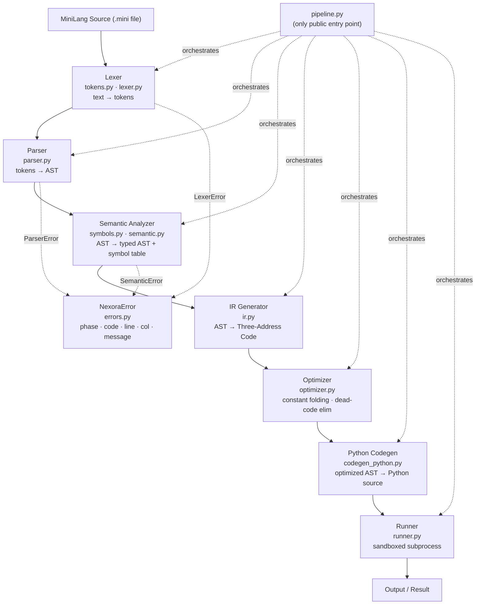

Backend is built first. The frontend (code editor + compiler visualizer) is built last.

---

## 2. Current status

Update this table in the same PR that changes a phase's status.

| Phase | Files | Status | Governing RFC |
|---|---|---|---|
| Errors / diagnostics | `errors.py` | Implemented | RFC-0004 |
| Tokens + Lexer | `tokens.py`, `lexer.py` | Implemented (COLON, ASCII-only amendments complete) | RFC-0001 |
| AST nodes | `ast_nodes.py` | Implemented | RFC-0003 |
| Parser | `parser.py` | Not started | RFC-0001, RFC-0003 |
| Symbol table + Semantic | `symbols.py`, `semantic.py` | Not started | RFC-0005 |
| IR (TAC) | `ir.py` | Not started | RFC-0006 (planned) |
| Optimizer | `optimizer.py` | Not started | RFC-0007 (planned) |
| Python codegen | `codegen_python.py` | Not started | RFC-0008 (planned) |
| Runner + API | `runner.py`, `api.py` | Not started | RFC-0009 (planned) |
| Frontend | `frontend/` | Not started | RFC-0010 (planned) |

Never describe a feature as "implemented" anywhere (README, portfolio, UI) until it is built **and** tested.

### Phase Completion Overview

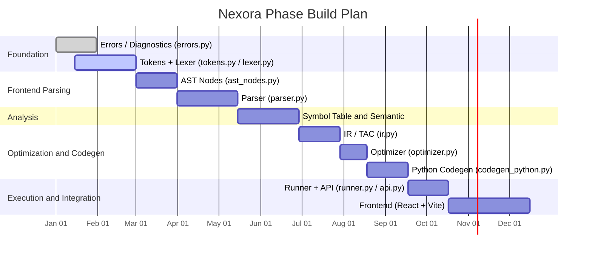

---

## 3. Tech stack

| Area | Choice |
|---|---|
| Language | Python 3.10+ (dataclasses with `kw_only`, `match`, `X \| None` types) |
| Compiler core dependencies | **Standard library only**. No PLY, ANTLR, Lark, etc. Lexer and parser are hand-written (recursive descent). |
| Tests | `pytest` |
| Lint / format | `ruff` (`ruff check .` and `ruff format .`) |
| API | FastAPI + Uvicorn (added only in the API phase) |
| Execution | `subprocess` with timeout and resource limits. Never `exec()` / `eval()` user code in the server process. |
| Frontend (last) | React + Vite, Monaco Editor (or CodeMirror), Tailwind CSS |

Third-party packages are allowed only outside the compiler core (`api.py`, tests, tooling) and must be added to `requirements.txt` with a one-line justification in the PR.

---

## 4. Setup and commands

Run everything from `backend/`.

```bash
# one-time setup
python -m venv venv
# Windows PowerShell:  venv\Scripts\Activate.ps1
# Windows cmd:         venv\Scripts\activate.bat
# Linux / macOS:       source venv/bin/activate
pip install -r requirements.txt

# every day
pytest -v                      # run all tests
pytest tests/test_lexer.py -v  # run one test file
ruff check .                   # lint
ruff format .                  # format
python main.py examples/hello.mini   # run the CLI on a MiniLang file
uvicorn api:app --reload             # start the API (after the API phase exists)
```

`requirements.txt` (initial):

```
pytest
ruff
```

Before declaring any task finished, `pytest -v` and `ruff check .` must both pass.

---

## 5. Repository map

```
nexora/
├── AGENTS.md                  # this file
├── rules.md                   # engineering rules for the team
├── docs/
│   └── rfcs/                  # design decisions (RFC-0001 … RFC-0010)
├── backend/
│   ├── nexora/                # the compiler package
│   │   ├── __init__.py
│   │   ├── errors.py          # NexoraError + diagnostics
│   │   ├── tokens.py          # TokenType, Token, KEYWORDS
│   │   ├── lexer.py           # Lexer
│   │   ├── ast_nodes.py       # AST dataclasses + NodeVisitor
│   │   ├── parser.py          # recursive-descent Parser
│   │   ├── symbols.py         # Symbol, Scope, SymbolTable, Type
│   │   ├── semantic.py        # SemanticAnalyzer
│   │   ├── ir.py              # TAC instructions + generator
│   │   ├── optimizer.py       # constant folding, etc.
│   │   ├── codegen_python.py  # Python code generator
│   │   ├── runner.py          # sandboxed execution
│   │   └── pipeline.py        # chains all phases; the only public entry point
│   ├── api.py                 # FastAPI app (thin wrapper over pipeline)
│   ├── main.py                # CLI
│   ├── examples/              # sample .mini programs
│   ├── tests/
│   │   ├── fixtures/          # .mini inputs (valid/, invalid/)
│   │   ├── golden/            # expected generated Python
│   │   └── test_*.py
│   └── requirements.txt
└── frontend/                  # built last
```

### Module Dependency Graph

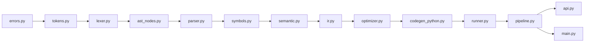

> **Import rule:** Arrows show the only permitted import direction. No backwards imports allowed — violating this is a bug.

MiniLang source files use the extension **`.mini`**.

---

## 6. Architecture rules (non-negotiable)

1. **Phases are isolated.** Each phase consumes the previous phase's output data structure and nothing else. The parser never looks at raw source text; the code generator never looks at tokens.
2. **Import direction is one-way.** A module may import only from modules earlier in this chain (plus the standard library):
   `errors → tokens → lexer → ast_nodes → parser → symbols → semantic → ir → optimizer → codegen_python → runner → pipeline → api`
   A backwards import is a bug, not a shortcut.
3. **No global mutable state.** No module-level counters, caches, or singletons. Every compile starts from scratch (`Lexer(source)`, `Parser(tokens)`, …). Two compiles in the same process must not affect each other.
4. **Data out, not print.** Compiler code never calls `print()` and never reads files. It receives strings and returns data structures. Only `main.py` and `api.py` do I/O.
5. **Every phase output must be serializable** (`to_dict()` / dataclass → JSON) so the frontend can display it.
6. **`pipeline.py` is the only public entry point** for `main.py`, `api.py`, and tests that need the full flow.
7. **Python is generated from the AST**, not from TAC. TAC is generated for analysis, optimization demos, visualization, and future targets (RFC-0002 §6).
8. **Errors carry location.** Every error has `phase`, `code`, `line`, `column`, `message` (RFC-0004).

### Error Class Hierarchy

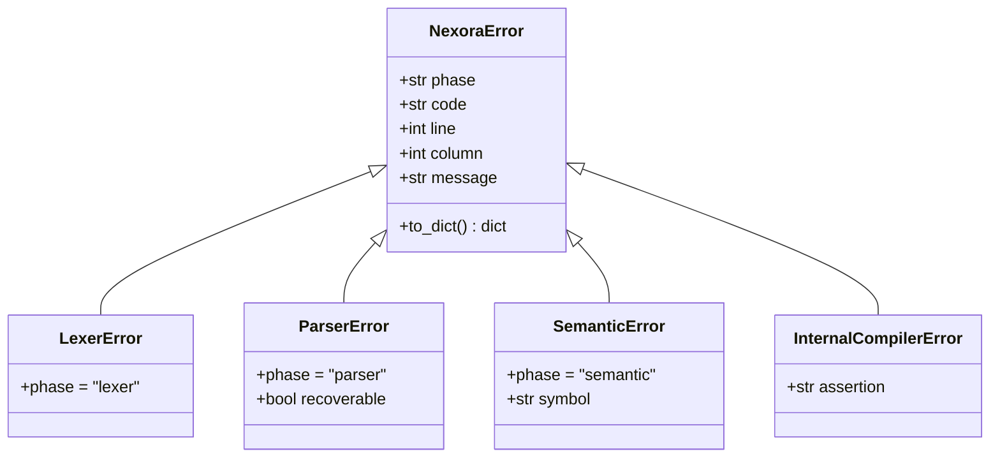

### Error Recovery Strategy

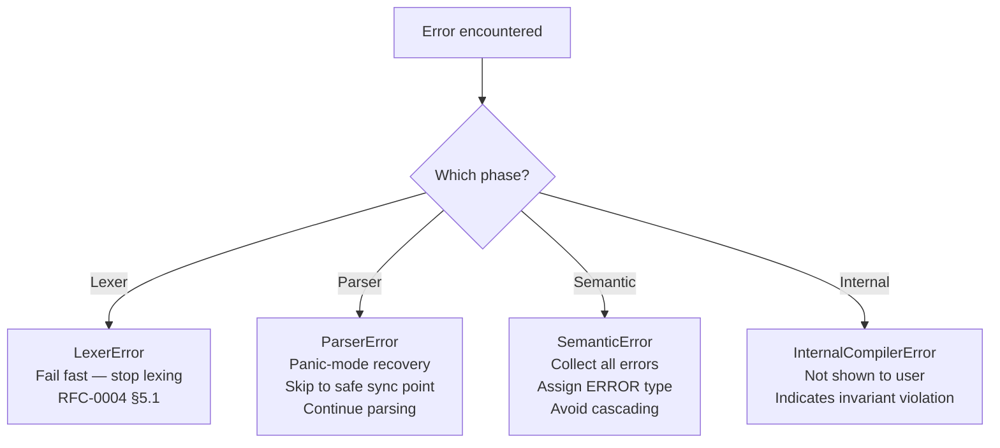

---

## 7. MiniLang quick reference

Authoritative definition: **RFC-0001**. This is a summary only.

```
// comment
make age = 20;                    // type inferred: int
make price: float = 5;            // optional annotation (int widens to float)
age = age + 1;                   // assignment, type must match

task add(x: int, y: int): int {
    give x + y;
}

task greet(name: string) {   // no return type = void
    show("Hello " + name);
}

when (age >= 18 both age < 60) {
    show("adult");
} otherwise when (age >= 60) {
    show("senior");
} otherwise {
    show("minor");
}

during (age < 25) {
    age = age + 1;
}

show(add(2, 3));
```

- Types: `int`, `float`, `string`, `bool`, `empty` (plus `void` for tasks with no return type).
- Keywords: `make show ask when otherwise during task give yes no both either not empty stop skip`.
- Operators by precedence (low → high): `either`, `both`, `not`, `== !=`, `< <= > >=`, `+ -`, `* / %`, unary `-`.
- Statements end with `;`. Blocks use `{ }`. `when`/`during` conditions use `( )` and must be `bool`.
- Statically typed, no implicit conversions except `int → float` widening.
- No shadowing. Tasks are declared at top level only.

### Operator Precedence (low → high)

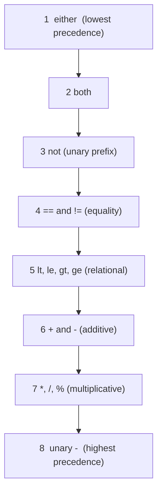

### Type System

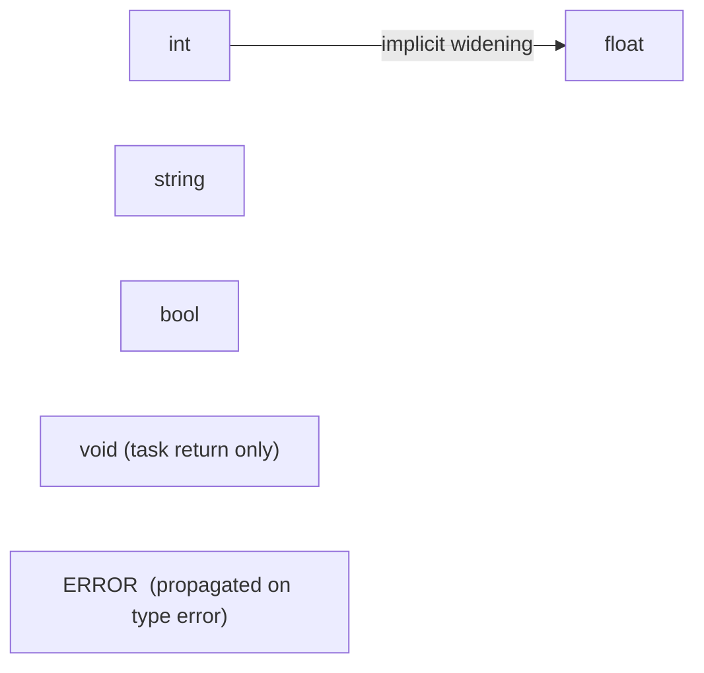

---

## 8. Playbooks

### 8.1 Implementing a compiler phase

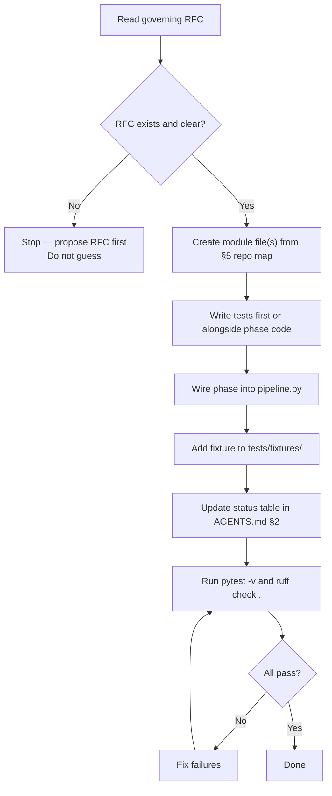

1. Read the governing RFC. If it does not exist or is unclear, **stop and propose an RFC**; do not guess.
2. Create the module file(s) listed in §5. Put only that phase's logic in them.
3. Write the tests first or alongside (see §9). Aim for the invariants listed in RFC-0002 §4 (phase contracts).
4. Wire the phase into `pipeline.py`.
5. Add at least one end-to-end fixture in `tests/fixtures/`.
6. Update the status table in §2.
7. Run `pytest -v` and `ruff check .`.

### 8.2 Adding or changing a language feature

A language change touches many files. Follow this checklist in order and do not skip steps:

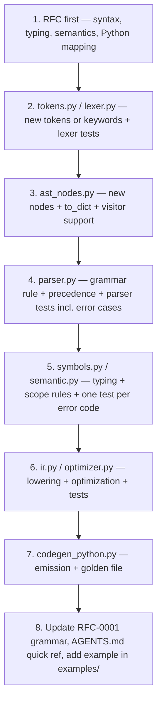

### 8.3 Fixing a bug

1. Reproduce with a failing test (minimal `.mini` input or direct unit call).
2. Fix the root cause in the phase that owns the bug, not in a later phase that happens to hide it.
3. Keep the regression test.

### 8.4 Adding an error or warning

1. Pick the next free code in the right range (RFC-0004 §4).
2. Add it to the code table in RFC-0004 in the same PR.
3. Write a test asserting `code`, `line`, `column`, and the message text.

---

## 9. Testing requirements

- Every public class and function has unit tests. Every error code has at least one test that triggers it.
- Error tests assert **code, line, and column**, not just that "an error happened".
- Lexer, parser, and semantic phases each need both *valid* and *invalid* fixtures.
- **Golden tests** for codegen: `tests/golden/<name>.mini` + `tests/golden/<name>.py.expected`. Changing a golden file requires a note in the PR explaining why.
- **Round-trip / behaviour tests:** run the generated Python and assert on its output for programs in `examples/`.
- Tests must be deterministic and independent (no ordering assumptions, no network, no wall-clock sleeps).
- Test names: `test_<unit>_<behavior>` (e.g. `test_lexer_rejects_unterminated_string`).

### Test Taxonomy

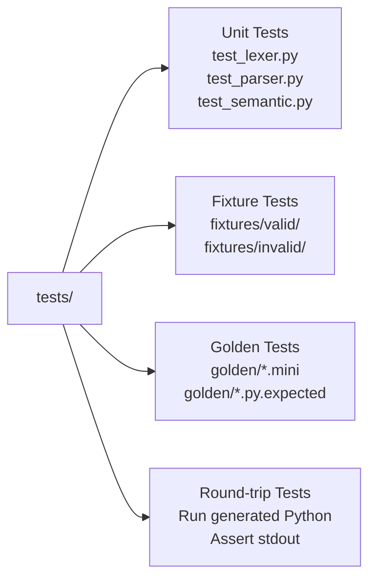

---

## 10. Error handling rules

- Use `NexoraError` subclasses (`LexerError`, `ParserError`, `SemanticError`) or the diagnostics collector defined in RFC-0004. Never raise bare `Exception`, `ValueError`, or `SystemExit` from compiler code for user mistakes.
- Lexer: fail fast (first error stops lexing, RFC-0004 §5.1).
- Parser: panic-mode recovery so several syntax errors can be reported in one run.
- Semantic analyzer: collect all errors; use the `ERROR` type to avoid cascading messages.
- Internal bugs (violated invariants) raise `AssertionError`/`InternalCompilerError`, which is *not* shown as a user error.
- Messages: say what is wrong, what was expected or found, and how to fix it when possible. Quote identifiers with single quotes.

---

## 11. Security rules

- **Never** run generated Python in the API process. Use `runner.py`: a separate `python` subprocess, `-I` isolated mode, hard timeout (default 5 s), output size cap (64 KB), no network, memory/CPU limits where the OS supports them, temporary working directory deleted afterwards.
- Never use `eval`, `exec`, `compile`, `os.system`, or `shell=True` anywhere in the compiler core.
- Limit input: source <= 64 KB, nesting depth <= 200, to avoid denial of service via pathological input.
- Do not log full user source in server logs.
- Do not commit secrets, `.env` files, or virtual environments.

### Sandboxed Execution Model

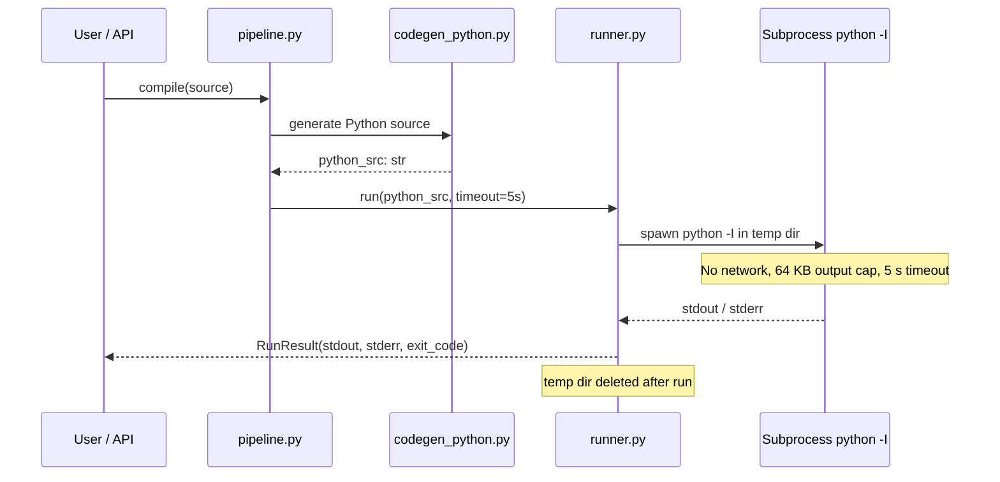

---

## 12. Git and PR rules for agents

- One logical change per commit; one feature or fix per PR.
- Commit messages follow Conventional Commits: `feat(parser): parse during statements`.
- Never force-push, rewrite shared history, or modify `main` directly.
- Never edit an RFC whose status is **Accepted** except through an amendment section approved per `rules.md` §9.
- Do not reformat unrelated files. Do not rename or move files without an RFC or explicit instruction.
- Do not delete tests to make a build pass.

---

## 13. How agents should respond to the team

The project owner prefers **step-by-step, file-by-file instructions that can be copy-pasted**.

- Give the **complete content** of a file (not fragments with "…rest unchanged") unless the change is a small, clearly located patch; for patches, state the file, the exact lines to find, and the exact replacement.
- State the file path before each code block.
- Provide exact terminal commands and the expected output.
- **Do not deliver zipped code packages** or tell the team to download an archive.
- After each step, say how to verify it (which test or command, what success looks like) and what comes next.
- If a request conflicts with an RFC or with this file, say so before writing code.

---

## 14. Do / Don't

**Do**
- Keep functions small and single-purpose; type-hint all public signatures.
- Prefer dataclasses and enums over dicts and magic strings.
- Track `line` and `column` on every token and AST node.
- Write the Python that Nexora generates so it is readable (real `if`/`while`/`def`, 4-space indentation).
- Ask for an RFC when the spec is ambiguous.

**Don't**
- Don't use regex-replace or string templates as a substitute for AST-based translation.
- Don't add features "while you're there" that no RFC covers.
- Don't catch broad exceptions to silence failures.
- Don't add dependencies to the compiler core.
- Don't mark TODOs without an issue reference (`# TODO(#12): ...`).

---

## 15. Definition of Done

A task is done only when:

- [ ] Behaviour matches the governing RFC.
- [ ] New/changed code has tests, including error cases; all tests pass.
- [ ] `ruff check .` and `ruff format --check .` pass.
- [ ] Public functions have type hints and docstrings.
- [ ] Docs updated (this file's status table, RFC if the design changed, examples).
- [ ] No regressions in golden or end-to-end tests.
- [ ] PR description explains *what* and *why* and lists how it was verified.

---

## 16. Ownership (initial split)

| Area | Primary owner |
|---|---|
| Lexer, parser, AST | Member 1 |
| Semantic analysis, symbol table, IR, optimizer, Python codegen | Member 2 |
| Language design, API, frontend, integration | Member 3 |
| Tests, documentation, research, demo/presentation | Member 4 |

Ownership means *first reviewer*, not *only editor*. The AST (RFC-0003) is the shared contract between members: changes to it need all owners' approval.

### Team Ownership Map

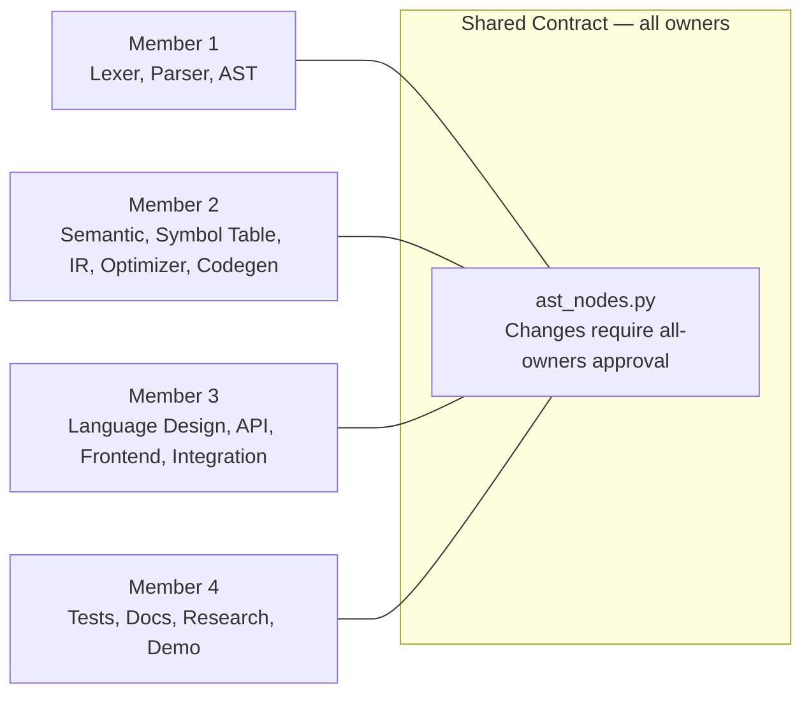

---

## 17. Glossary

| Term | Definition |
|---|---|
| **Token** | Smallest meaningful unit of source (keyword, identifier, number, operator). |
| **AST** | Abstract Syntax Tree; the program's structure as a tree. |
| **Symbol table** | Map of declared names to their kind, type, and scope. |
| **TAC** | Three-Address Code; IR where each instruction has at most one operator. |
| **Constant folding** | Evaluating constant expressions at compile time (`3 * 4` → `12`). |
| **Transpiler** | Compiler whose target is another high-level language. |
| **Panic-mode recovery** | After a syntax error, skip tokens to a safe point and continue parsing. |
| **Golden test** | Compares generated output to a stored, reviewed expected file. |
